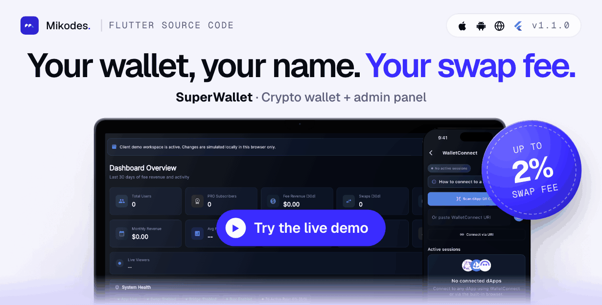
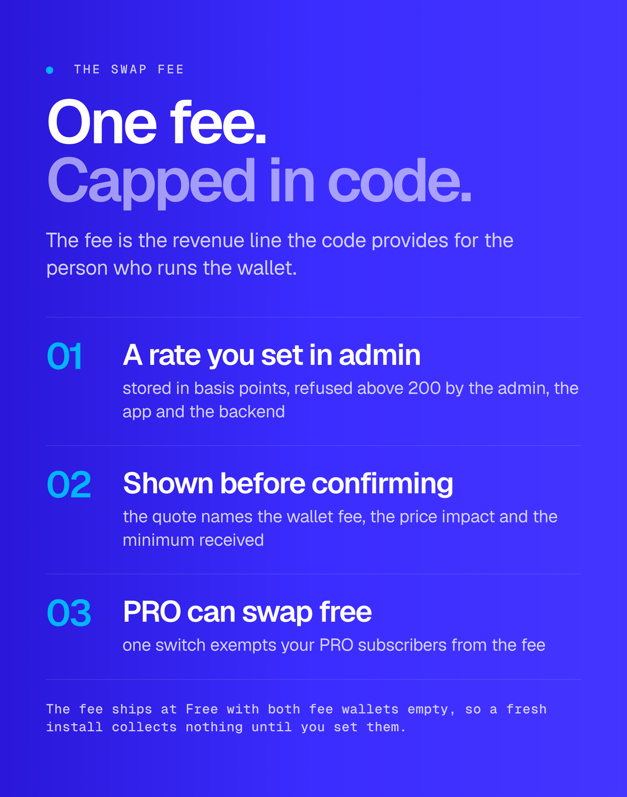
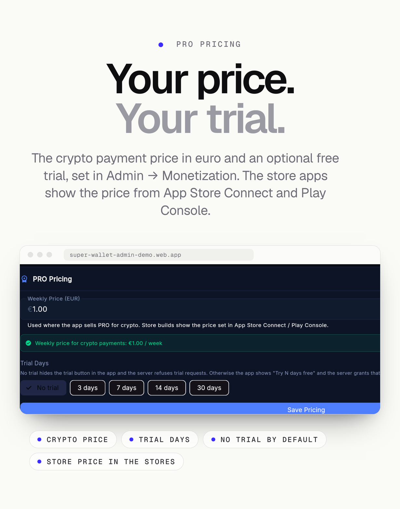
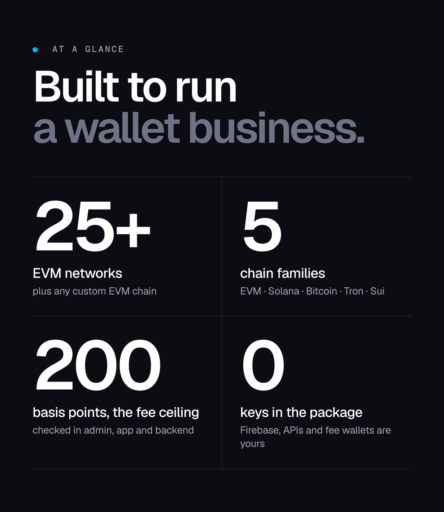
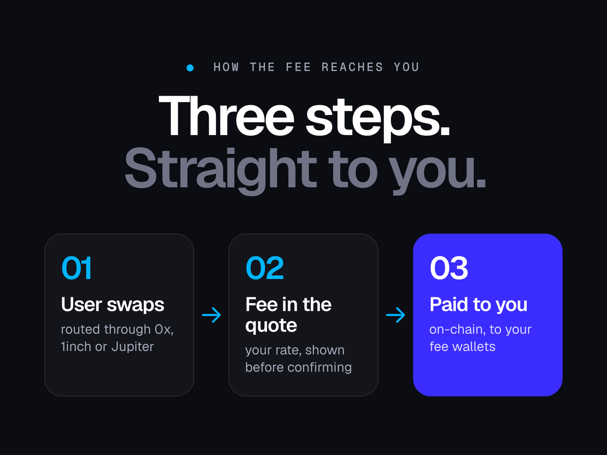
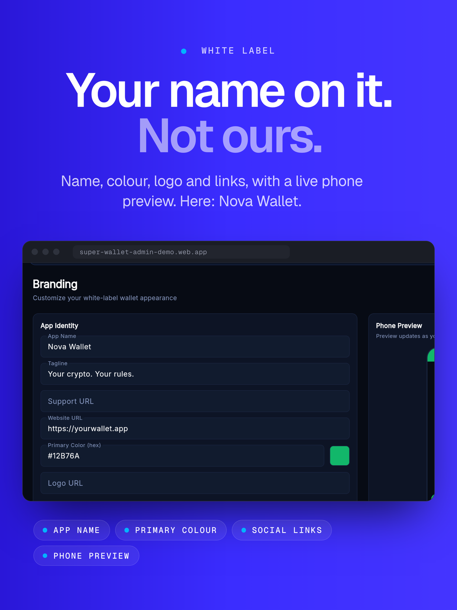
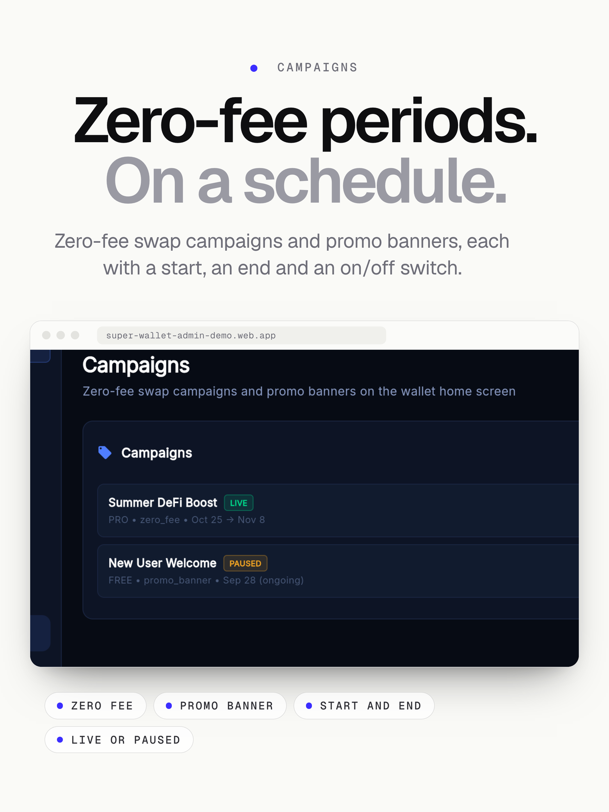

  

<h1 align="center">SuperWallet</h1>

  <b>Non-custodial multi-chain crypto wallet (Flutter) with an admin panel.</b>

Flutter crypto wallet source code · non-custodial multi-chain wallet app · iOS & Android · admin panel · white-label

  <a href="https://superwallet.mikodes.com/docs/"><b>Docs</b></a> ·
  <a href="https://superwallet.mikodes.com/"><b>Website</b></a> ·
  <a href="https://store.mikodes.com/p/superwallet/"><b>Get the full source code</b></a>

  
  
  

  

> **This repository is a showcase.** It holds screenshots, documentation pointers and a real excerpt
> from the code. The full application is sold as source code at
> **[store.mikodes.com/p/superwallet](https://store.mikodes.com/p/superwallet/)**: one payment, instant ZIP download, free setup help.

---

## What it is

A white-label crypto wallet for iOS and Android: EVM networks, Bitcoin, Solana, Tron and Sui, with in-app swaps and an operator admin panel for branding, push campaigns and an optional swap fee.

## Screens

 

 

 

## Features

- **Non-custodial multi-chain wallet: EVM networks, Bitcoin, Solana, Tron and Sui**
- **Operator swap fee on 0x and 1inch**
- **PRO subscription via App Store / Google Play and crypto payments**
- **Optional swap-fee waiver for PRO users**
- **Flutter web admin panel: branding, chains, tokens, dApps, feature switches, push, fee and PRO pricing**
- **Swap, bridge, card on-ramp, NFTs, dApp browser and WalletConnect v2**
- **Keys generated and stored on the device, biometric unlock**
- **Firebase backend: Firestore rules, Remote Config template and Cloud Functions**
- **Inactive revenue settings marked Not active in this version in the admin**

## How it works

A technical case study of the architecture, one end-to-end flow, the key engineering decisions and how you would build something like this: **[docs/HOW-IT-WORKS.md](docs/HOW-IT-WORKS.md)**.

## A look at the code

Real excerpts from the source, shown for illustration:

- **Swap fee config** ([`snippets/swap_fee_config.dart`](snippets/swap_fee_config.dart)): The operator swap fee is disabled by default and hard-capped at 2 %. The value is clamped on input and again on read, so a bad admin setting can never overcharge a user.
- **PRO plan pricing for crypto payments** ([`snippets/pro_crypto_plans.ts`](snippets/pro_crypto_plans.ts)): The server, not the app, decides what a PRO plan costs and how long it lasts. An unknown plan is refused, an unpriced plan is not sold for crypto, and a small tolerance covers price moves between sending and confirming.
- **Signing authentication gate** ([`snippets/signing_auth_gate.dart`](snippets/signing_auth_gate.dart)): One authentication opens a short grant (at most 60 seconds) that covers exactly the signatures one action needs. dApp requests always ask again, and with no authenticator attached it fails closed.

## Requirements (full version)

- Flutter 3.41.3 or newer on the stable channel, with Dart 3.11.1 or newer
- Node.js 22 LTS, Firebase CLI 13+, FlutterFire CLI
- Firebase project on the Blaze plan
- Xcode 15+ and CocoaPods 1.14+ on a Mac for iOS
- Android Studio 2024.3.1
- Reown

Not included: Hosting and domain; Third-party API subscriptions; Developer accounts; Blockchain network fees.

## FAQ

**Is this the full source code?**  
No. This repository is a showcase with screenshots, a technical case study and real code excerpts. The complete SuperWallet source code is sold at [store.mikodes.com/p/superwallet](https://store.mikodes.com/p/superwallet/).

**What is SuperWallet built with?**  
Firebase, Flutter.

**Can I try it before buying?**  
Look at the screenshots and the [case study](docs/HOW-IT-WORKS.md), or ask a question at [mikodes.com/support](https://mikodes.com/support).

**Do I get help with the installation?**  
Free setup help is included with the store purchase; questions go to [mikodes.com/support](https://mikodes.com/support).

## Get the full source code

  

One payment, full licence, instant ZIP download and free setup help.
Questions: [mikodes.com/support](https://mikodes.com/support).

---

  Made by <a href="https://mikodes.com"><b>MIKODES</b></a> · <a href="https://github.com/Mikodesteam">more projects</a>

