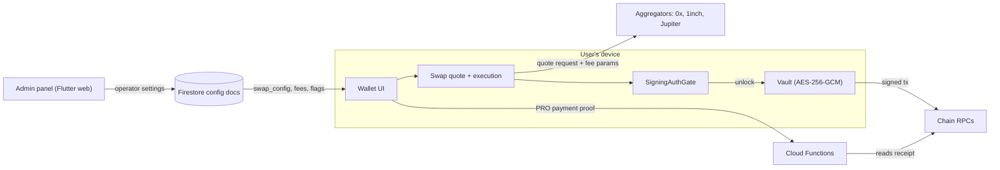

# How SuperWallet works

A case study of a white-label, non-custodial multi-chain wallet built with Flutter and Firebase.
It is written from the real code of the product, to show the engineering decisions behind it.
Short, verbatim excerpts are in [`../snippets/`](../snippets/).

## The problem and who it is for

A team that wants its own wallet app (its own name, colours, chains and fee policy) normally has two bad
options: fork an open-source wallet and spend months on maintenance, or pay a vendor and hand over control.
SuperWallet is the third option: a wallet app plus a web admin panel where the operator, not the end user,
controls branding, supported chains, tokens, dApps, feature switches, push campaigns, an optional swap fee
and PRO pricing. The end user's keys never leave the phone.

## Architecture

Two Flutter apps and a Firebase backend.

| Component | What it does |
| --- | --- |
| Wallet app | Holds the keys, builds and signs transactions, talks to chain RPCs and swap aggregators directly. Targets: iOS, Android, plus web, macOS, Windows and Linux builds. |
| Admin panel | A separate Flutter web app. Writes the operator's settings: branding, chains, tokens, dApps, feature switches, push, fee and PRO pricing. |
| Firestore | Admin-written configuration documents (for example `swap_config`), admin accounts, an append-only change log. |
| Remote Config | A template shipped with the project for runtime flags. |
| Cloud Functions | Admin sign-in and two-factor checks, PRO entitlement, store receipt checks, on-chain payment verification. |

The wallet never sends a private key or seed phrase to the backend. The backend only holds configuration
and entitlement state.

### What lives where

- **On the device:** seed and private keys (encrypted), the signing gate, contacts, address checks,
  quote requests, transaction building and signing.
- **In Firestore:** configuration the operator controls, read by signed-in wallet users.
- **In Cloud Functions:** anything that grants something of value (PRO) or touches secrets (admin
  two-factor material is kept in a server-only collection that client rules deny completely).
- **With third parties:** prices, swap quotes, RPC nodes, explorers. All are called with the
  buyer's own keys, configured in the project.

## One flow end to end: a swap from quote to signed transaction

1. **Operator policy is loaded.**
   - The wallet reads the `swap_config/global` document that the admin panel writes.
   - It becomes a `SwapPolicy`: preferred and fallback aggregator, default and maximum slippage,
     optional auto-slippage, gas speed.
   - Every field is nullable. If the operator never published a control, the policy is inert and the
     wallet uses its own built-in behaviour.
2. **Slippage is chosen and clamped.**
   - The starting value is the operator default, or the wallet's own 0.5 %.
   - Auto-slippage can only lower it (for example for stablecoin pairs), never widen it.
   - Non-finite and negative values are rejected; the operator ceiling is applied on every read.
3. **Quotes are requested.**
   - 0x and 1inch are asked on EVM networks, Jupiter on Solana.
   - When the operator fee is active, the fee parameters are added in each provider's own vocabulary:
     for 0x a fee recipient, basis points and fee token; for 1inch a referrer address; for Jupiter a
     platform fee in basis points plus a fee account.
   - The fee is off by default and capped at 2 % (see [`swap_fee_config.dart`](../snippets/swap_fee_config.dart)).
4. **A route is picked.** A comparator scores each quote by output amount, minus the estimated network
   fee and the price impact, with a tiny preference for routes that need no token approval.
5. **The quote is checked before execution.**
   - An expired quote is refused ("refresh before execution").
   - A route that needs a token approval is refused until the approval is granted.
   - A quote that came back without transaction calldata (an indicative price only) is never
     broadcast. The service returns an honest "estimated only" simulated result instead.
6. **Authentication gate.**
   - Before any signature the app calls the signing gate, see [`signing_auth_gate.dart`](../snippets/signing_auth_gate.dart).
   - In a browser every signature asks for the vault passphrase.
   - On devices, authentication is required from a USD threshold, and also whenever the amount cannot
     be valued at all.
   - A successful check opens a grant of at most 60 seconds that covers exactly the number of
     signatures the action needs (an approval followed by a swap asks for two).
7. **Signing and broadcast.** The vault decrypts the key material for the signature and the transaction is
   sent to the chain RPC.
8. **Lifecycle tracking.** A watcher follows the hash through its states, and the result carries flags
   for whether speed-up and cancel are possible for that route.

## Key engineering decisions

### 1. An unset admin control means "off", never "ours"

- **Chosen:** nullable settings and inert policy objects. The swap fee is disabled by default.
- **Alternative:** ship vendor defaults (a default fee wallet, a default aggregator) that the operator
  may override.
- **Why:** a missing field would silently route money or traffic to someone else. For a white-label
  product the buyer's control must be total, so absence of a setting has to mean absence of a feature.

### 2. Clamp at both ends

- **Chosen:** the fee percentage is clamped when it is set and again when it is read; slippage is
  clamped on every read.
- **Alternative:** validate once in the admin panel.
- **Why:** the admin is a separate app writing to a database. A corrupted document, an old admin build
  or a manual edit could otherwise overcharge users. The wallet treats everything it reads from
  configuration as untrusted input.

### 3. Pricing and plan length live on the server

- **Chosen:** when a user pays for PRO in crypto, the client only names a plan. The Cloud Function looks
  up the price and the number of days from the operator settings, see
  [`pro_crypto_plans.ts`](../snippets/pro_crypto_plans.ts).
- **Alternative:** let the app send the amount and duration.
- **Why:** a modified client could then buy a year for the price of a week. An unknown plan id is
  refused rather than mapped to a default, and a plan the operator has not priced is not sold for
  crypto at all.

### 4. Verify the payment from the chain, not from the client

- **Chosen:** the function reads the transaction and its receipt itself, then checks confirmations,
  the recipient, the amount in EUR and that the payer controls the paying address.
- **Alternative:** trust a "payment done" message from the app, or a transaction hash alone.
- **Why:** a hash is public. Without a binding to the account anyone could claim someone else's payment.

### 5. One authentication per action, not per signature and not per session

- **Chosen:** a grant with a count and a 60-second window. It is revoked when the wallet locks, the
  account or wallet changes, or the app is paused. dApp and WalletConnect requests always ask again.
- **Alternatives:** ask on every signature (annoying when a swap needs an approval and a swap), or
  unlock once per session (unsafe).
- **Why:** it keeps the prompt where it matters and removes it where it only trains users to tap through.

## Security and safety measures that exist in the code

- **Keys are generated and stored on the device.**
  - The vault uses AES-256-GCM. New values carry a `v2:` prefix; legacy CBC values are read and
    migrated, and a failed GCM tag raises a corruption error instead of returning garbage.
  - Secure storage and biometric unlock are used on mobile.
- **Passphrase key derivation.** The web vault passphrase and encrypted backups use PBKDF2-HMAC-SHA256
  with 600,000 iterations. On web it runs in the browser's native crypto; elsewhere on a background
  isolate so the UI does not freeze. Both paths produce identical bytes.
- **Fail closed.** The signing gate returns "not authenticated" when no authenticator is attached, so
  nothing signs before the wallet is set up.
- **Unknown value is treated as large.** If a token has no price, the amount is not treated as small.
- **Address checks.** A detector compares an entered address with known addresses and contacts and flags
  near-duplicates (the "address poisoning" trick of imitating the first and last characters). It uses a
  similarity score plus a prefix-and-suffix rule, and highlights the differing characters.
- **dApp and signature warnings.** Separate risk services exist for token approvals, signature
  requests and phishing domains.
- **PRO crypto payments:**
  - rate limited per user (20 calls per 5 minutes);
  - accepted networks and tokens are an allow list;
  - a signature from the paying wallet over a message bound to the user, the hash and the chain;
  - a confirmation count read from the chain;
  - a transaction that already activated PRO can never activate it again.
- **Store subscriptions** are tied to the account: the app passes an account token to the store and the
  server reads the subscription from Apple or Google itself, refusing it unless the token matches.
- **Firestore rules.** Wallet users can read the configuration they need but not write it; writes
  require a provisioned admin; the change log is write-once; sensitive collections are closed to clients.
- **Honest admin.** Settings that do nothing in this version are labelled "Not active in this version"
  instead of being shown as working.

## Testing approach

- The policy-style code is deliberately pure so it can be tested without a device or a Firebase
  project: fee clamping, slippage policy, address similarity, PRO plan terms, store entitlement.
- The Flutter side has a large unit and widget test folder.
- The Cloud Functions have Node tests that run against plain fakes of the database.

## How you would build something like this

1. **Start from the trust boundary.** Decide what must never leave the device (seed, keys) and design
   every other component around that. Configuration and entitlement are untrusted input to the wallet
   and trusted state on the server.
2. **Build the vault first.** Authenticated encryption, a versioned format with a migration path, and a
   derivation function with a sensible cost. Then secure storage and biometrics per platform.
3. **Add one chain at a time behind a common interface** (balance, send, receive, history, explorer link):
   EVM first, then Solana and Bitcoin. Keep per-chain code out of the UI.
4. **Add a single signing choke point before you add features.** Every send, approval, swap and dApp
   signature goes through it. Adding it later means hunting for call sites.
5. **Integrate swap aggregators with a quote model** that carries expiry, approval need, calldata presence
   and fee. Separate "quote" from "execution" so you can run an honest simulation mode.
6. **Make configuration remote but defensive:** nullable settings, clamping on read, defaults that mean "off".
7. **Only then add monetisation** (fee parameters, subscriptions) and verify anything that touches money on
   the server, from public chain data or from the store's own API.
8. **Write tests first for the pure policy code.** It is the code that costs real money if it regresses.

## Deployment and customization

- **Build:** the wallet and the admin panel are built with the Flutter SDK; the backend is a Firebase
  project (Firestore rules, Remote Config template, Cloud Functions on Node.js) on the Blaze plan.
- **You bring:** your own Firebase project, Apple and Google developer accounts, a domain, and
  third-party API keys for the services you enable.
- **Customize without a rebuild:** branding, chains, tokens, dApps, feature switches, push campaigns, the
  swap fee and PRO pricing, from the admin panel.
- **Customize in code:** new chains, screens and flows, in Dart.
- **Not included with the source:** hosting, developer accounts, API subscriptions and network fees.

Full source code, docs and setup help: https://store.mikodes.com/p/superwallet/
